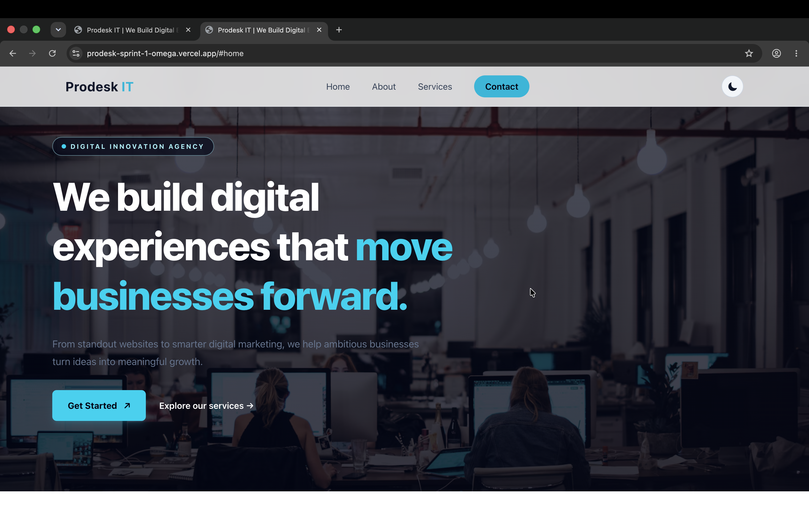
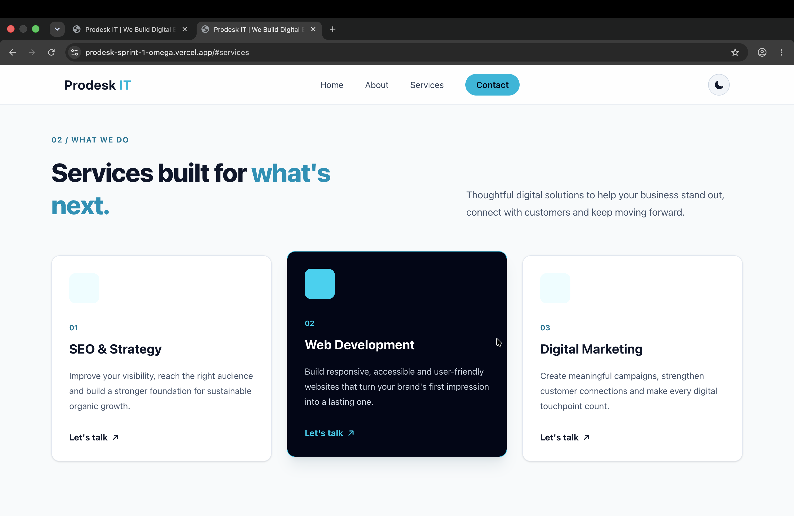
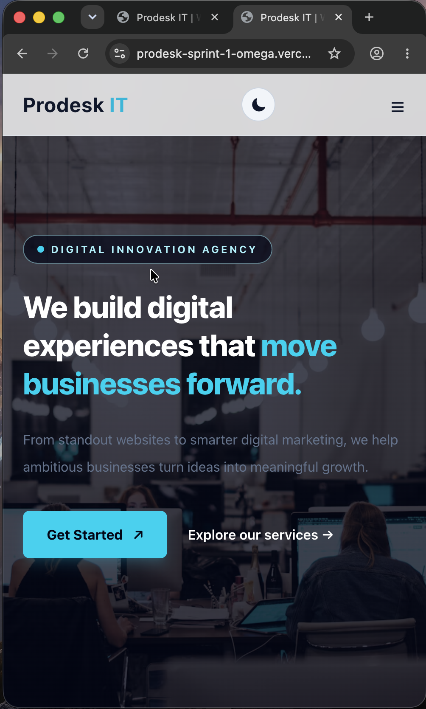

# Prodesk IT – Responsive Landing Page

A modern, professional, and responsive landing page developed for **Prodesk IT**, a digital marketing company, as part of Sprint 1.

The website is designed to provide a clean user experience, showcase company services, and work smoothly across desktop, tablet, and mobile devices.

## 🌐 Live Demo

**Live Website:** https://prodesk-sprint-1-omega.vercel.app/

## 📌 Project Overview

The objective of this project was to build a professional landing page using foundational web technologies, focusing on responsive layouts, clean UI design, and interactive functionality.

The project demonstrates the use of HTML, Tailwind CSS, CSS Grid, Flexbox, and JavaScript.

## ✨ Features

- **Responsive Navigation Bar:** Navigation links for Home, About, Services, and Contact.
- **Mobile Navigation:** Hamburger menu for smaller screens.
- **Hero Section:** Attractive headline, background image, description, and call-to-action button.
- **About Section:** Introduction to Prodesk IT.
- **Services Section:** Three service cards showcasing company offerings.
- **Responsive Layout:** Adapts to desktop, tablet, and mobile screens.
- **Modern UI:** Clean design, typography, spacing, and visual styling.
- **Interactive Elements:** JavaScript-based functionality.

## 🛠️ Technologies Used

| Technology | Purpose |
|---|---|
| HTML5 | Website structure |
| Tailwind CSS | Styling and responsive design |
| CSS3 | Custom styling |
| JavaScript | Interactive functionality |
| Git & GitHub | Version control |
| Vercel | Deployment |

## 📂 Project Structure

```text
sprint-1/
│
├── index.html
├── css/
│   ├── input.css
│   ├── tailwind.css
│   └── style.css
│
├── js/
│   └── script.js
│
├── Prompts.md
├── README.md
├── package.json
└── package-lock.json
```


## 🚀 Getting Started

Follow these steps to run the project locally.

### 1. Clone the repository

```bash
git clone https://github.com/debang123/my_Sprint.git
```

### 2. Navigate to the project folder

```bash
cd my_Sprint
```

### 3. Install dependencies

```bash
npm install
```

### 4. Build Tailwind CSS

```bash
npm run build
```

### 5. Run the project

Open `index.html` in your browser or use the VS Code Live Server extension.

## 📱 Responsive Design

The website is designed to support different screen sizes:

- Desktop screens
- Tablet screens
- Mobile screens

Responsive layouts are implemented using Tailwind CSS utilities, CSS Grid, and Flexbox.

## ☁️ Deployment

The project is deployed using **Vercel**.

**Live URL:** https://prodesk-sprint-1-omega.vercel.app/

## 🤖 AI Assistance

AI tools were used during development for:
- UI improvement suggestions.
- Debugging and troubleshooting.

For the development prompt documentation, see [Prompts.md](./Prompts.md).

## 📸 Screenshots

### Homepage – Desktop


### Services Section


### Mobile Responsive View


## 👨‍💻 Author

**Name:** Debang Bhaskar

**GitHub:** https://github.com/debang123

## 📄 License

This project was created for educational and sprint evaluation purposes.
